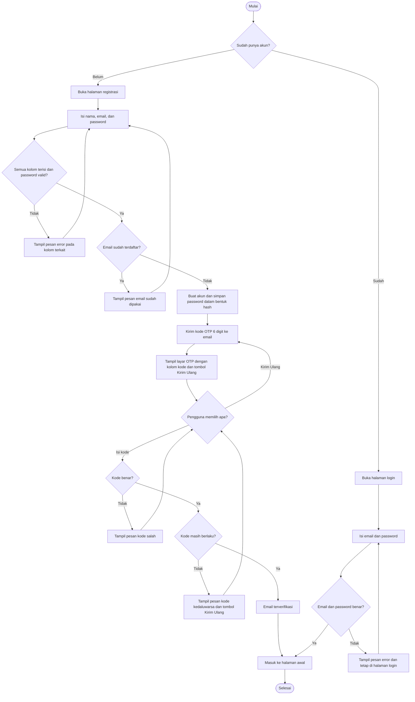

# User Flow: Registrasi dan Login (US-01)

Tujuan: pemilik UKM calon penerbit membuat akun dan login, agar data profil dan dokumen tersimpan dan hanya bisa diakses oleh dirinya.
Titik awal: pengguna membuka SCOUT dan ingin masuk.
Titik akhir: pengguna berada di halaman awal setelah berhasil daftar (termasuk verifikasi kode OTP) atau login.

## Terhubung ke

US-01 Registrasi dan Login (F-01). Referensi: BR-05, Non-Fungsional (keamanan).
Halaman terkait: beranda (US-14), dashboard atau halaman awal (US-16), logout (US-13), reset password (US-21), verifikasi email dengan OTP (US-24), halaman error (US-23).

## Jalur dan acuan acceptance criteria

| Jalur | Langkah | Acceptance criteria |
| --- | --- | --- |
| J1 | Belum punya akun, mengisi data valid, akun terbuat, kode OTP dikirim, layar OTP tampil, kode benar, masuk halaman awal | AC1 (diubah) |
| J2 | Mendaftar dengan email yang sudah terdaftar, tampil error email sudah dipakai | AC2 |
| J3 | Sudah punya akun, login dengan data benar, masuk halaman awal | AC3 |
| J4 | Login dengan password salah, tampil error, tetap di halaman login | AC4 |
| J5 | Akun terbuat, password tersimpan dalam bentuk hash, bukan teks polos | AC5 (dicek di database, bukan di layar) |
| J6 | Registrasi dengan kolom kosong atau password tidak valid, tampil error di kolom | Tambahan (validasi input) |
| J7 | Di layar OTP, memasukkan kode salah, tampil pesan kode salah, pengguna bisa mengisi lagi | Tambahan (OTP), aturan lengkap di US-24 |
| J8 | Di layar OTP, memasukkan kode yang sudah kedaluwarsa, tampil pesan dan tombol Kirim Ulang | Tambahan (OTP), aturan lengkap di US-24 |
| J9 | Di layar OTP, menekan Kirim Ulang, kode baru dikirim ke email | Tambahan (OTP), aturan lengkap di US-24 |

## Dipakai role lain

- UI/UX: tiap kotak langkah menjadi satu layar atau komponen, yaitu form registrasi, form login, layar OTP (kolom kode 6 digit, tombol Kirim Ulang, pesan kode salah dan kedaluwarsa), pesan error pada kolom, dan halaman awal.
- Vibe Coder: pengecekan "Email sudah terdaftar?" dan "Email dan password benar?" menjadi logika validasi di server. Password disimpan dalam bentuk hash. Pembuatan kode OTP, pengiriman email, dan pengecekan "Kode benar?" serta "Kode masih berlaku?" juga dilakukan di server.
- QA: tiap jalur J1 sampai J9 menjadi minimal satu skenario di `test-cases.xlsx`. Jalur J5 diuji dengan memeriksa tabel pengguna di database.
