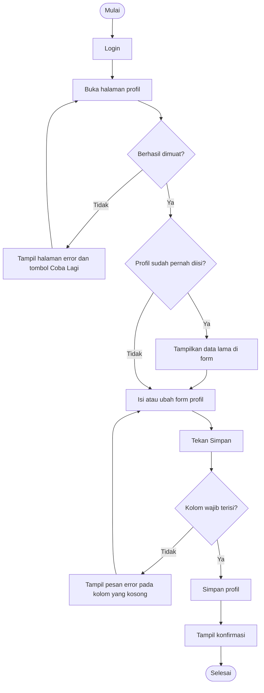

# User Flow: Mengisi Profil Bisnis (US-02)

Tujuan: pemilik UKM calon penerbit mengisi profil bisnis dan kebutuhan dana, agar SCOUT bisa menyesuaikan checklist dokumen dan mencocokkannya dengan penyelenggara SCF.
Titik awal: pengguna login dan membuka halaman profil.
Titik akhir: profil tersimpan dan konfirmasi tampil.

## Terhubung ke

US-02 Mengisi Profil Bisnis (F-02). Referensi: BR-04 dan BR-05.
Profil ini dipakai oleh checklist dokumen (US-03) dan kecocokan penyelenggara (US-05), serta kelengkapannya tampil di dashboard (US-16). Pilihan jenis efek ditambahkan di US-27, dan penyelenggara tujuan diisi lewat US-35.
Halaman terkait: login (US-01), halaman error (US-23).

## Jalur dan acuan acceptance criteria

| Jalur | Langkah | Acceptance criteria |
| --- | --- | --- |
| J1 | Profil belum pernah diisi, form tampil dengan bentuk badan hukum, sektor usaha, kebutuhan dana, dan kondisi dokumen | AC1 |
| J2 | Kolom wajib kosong, menekan Simpan, tampil error pada kolom dan profil tidak tersimpan | AC2 |
| J3 | Semua kolom wajib terisi, menekan Simpan, profil tersimpan dan konfirmasi tampil | AC3 |
| J4 | Profil sudah pernah diisi, data lama tampil di form dan bisa diubah | AC4 |
| J5 | Halaman profil gagal dimuat, tampil halaman error dan tombol Coba Lagi | Tambahan (halaman error), aturan lengkap di US-23 |
