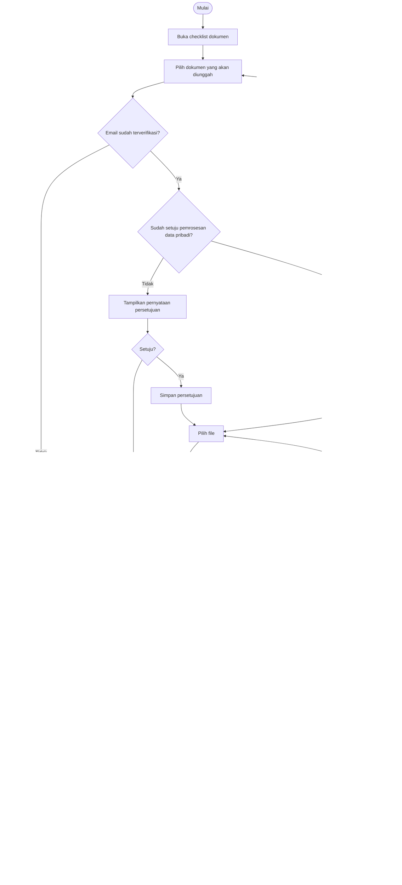

# User Flow: Mengunggah Dokumen dan Memantau Status (US-04)

Tujuan: pemilik UKM calon penerbit mengunggah dokumen dan melihat progres kelengkapannya, agar tahu mana yang sudah lengkap dan mana yang masih kurang.
Titik awal: pengguna login dan membuka checklist dokumen.
Titik akhir: dokumen tersimpan dengan status lengkap dan progres tampil, atau unggahan ditolak karena email belum terverifikasi atau persetujuan data belum diberikan.

## Terhubung ke

US-04 Mengunggah Dokumen dan Memantau Status (F-04). Referensi: BR-04, BR-05, Non-Fungsional (keamanan).
Keputusan "Email sudah terverifikasi?" memakai status verifikasi dari US-24 dan US-01. Keputusan "Sudah setuju pemrosesan data pribadi?" memakai persetujuan dari US-17 (BR-04). Dokumen hanya bisa diakses pemilik akun (BR-05).
Halaman terkait: checklist dokumen (US-03), pratinjau dan unduh dokumen (US-29), penilaian AI (US-06), notifikasi status (US-10), halaman error dan loading (US-23).

## Jalur dan acuan acceptance criteria

| Jalur | Langkah | Acceptance criteria |
| --- | --- | --- |
| J1 | Email terverifikasi dan sudah setuju, file valid, file tersimpan dengan status lengkap | AC3 |
| J2 | Email belum terverifikasi, unggahan ditolak dengan pesan verifikasi email | AC1 |
| J3 | Email terverifikasi, belum setuju lalu menolak, unggahan ditolak | AC2 |
| J4 | Email terverifikasi, belum setuju lalu setuju, persetujuan tersimpan, lanjut memilih file | AC2 dan AC3 |
| J5 | File berformat tidak didukung atau terlalu besar, tampil error, status tidak berubah | AC4 |
| J6 | Beberapa dokumen terunggah, progres menampilkan jumlah lengkap dari total dan persentase | AC5 |
| J7 | Dokumen yang sudah punya file diganti, file lama digantikan dan status diperbarui | AC6 |
| J8 | Pengguna lain mencoba membuka dokumen, akses ditolak | AC7 (dicek di server, bukan di alur layar) |
