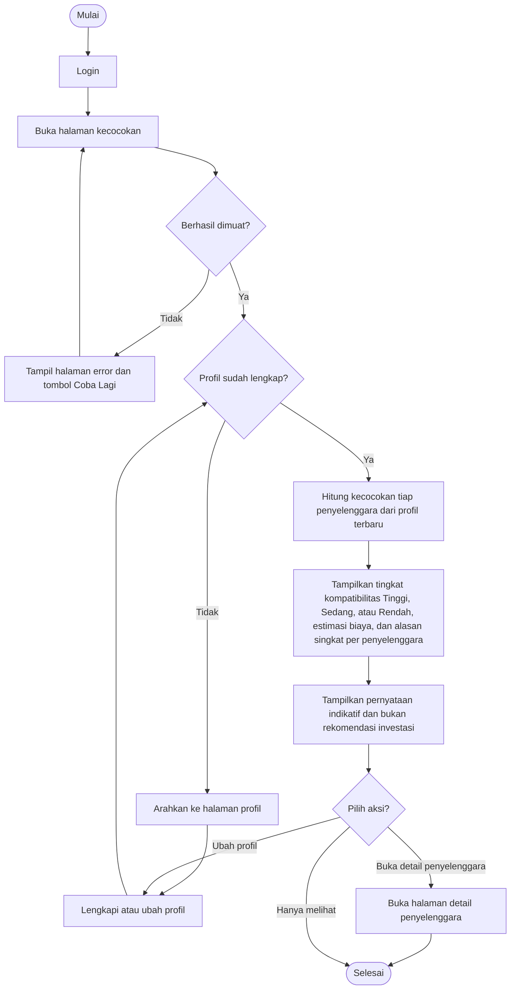

# User Flow: Melihat Kecocokan Penyelenggara (US-05)

Tujuan: pemilik UKM calon penerbit melihat penyelenggara SCF yang paling cocok dengan profil usahanya, agar bisa memilih tujuan pengajuan dengan lebih yakin.
Titik awal: pengguna login dan membuka halaman kecocokan.
Titik akhir: hasil kecocokan tampil beserta pernyataan indikatif, atau pengguna diarahkan melengkapi profil dulu.

## Terhubung ke

US-05 Melihat Kecocokan Penyelenggara (F-06). Referensi: BR-01, BR-02, BR-06, BR-07, dan data penyelenggara (dummy untuk MVP).
Keputusan "Profil sudah lengkap?" memakai profil dari US-02. Pernyataan indikatif sejalan dengan US-18. Pilihan jenis efek di US-27 menjadi salah satu kriteria, dan halaman detail penyelenggara ada di US-35.
Halaman terkait: dashboard (US-16), halaman error (US-23), bandingkan penyelenggara (US-36).
