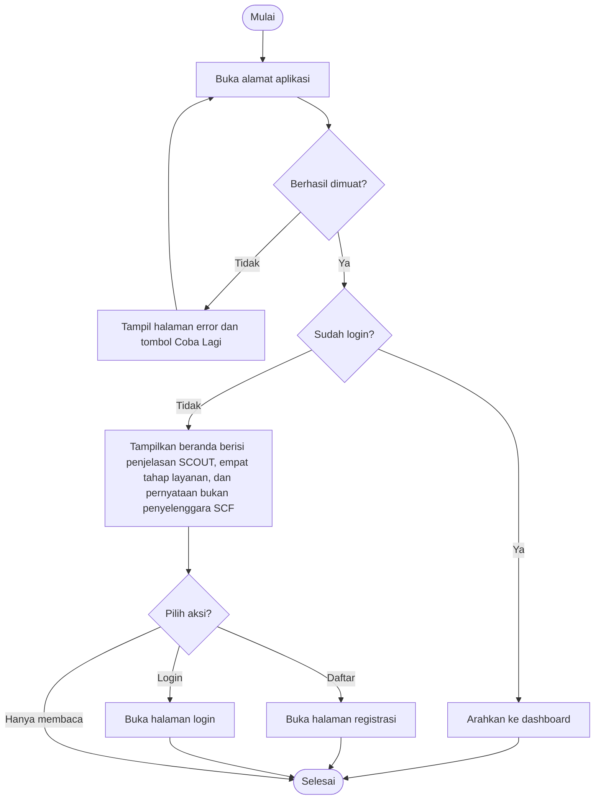

# User Flow: Beranda (US-14)

Tujuan: calon pengguna melihat halaman beranda yang menjelaskan SCOUT, agar paham manfaatnya sebelum mendaftar.
Titik awal: pengguna membuka alamat aplikasi.
Titik akhir: pengguna membaca beranda lalu memilih Daftar atau Login, hanya membaca, atau diarahkan ke dashboard bila sudah login.

Empat tahap layanan SCOUT: PREPARE, ASSESS, MATCH, dan ONBOARD.
