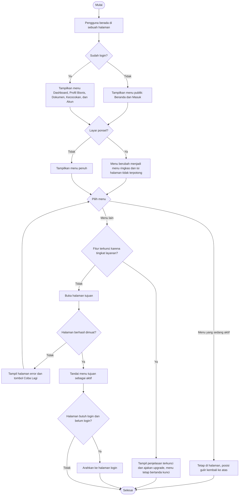

# User Flow: Navigasi Menu dan Tampilan Responsif (US-15)

Tujuan: pengguna berpindah antar halaman lewat menu yang jelas dan nyaman di ponsel, agar tidak bingung memakai aplikasi.
Titik awal: pengguna berada di sebuah halaman aplikasi.
Titik akhir: halaman tujuan terbuka dengan menu aktif ditandai, atau pengguna tahu fitur terkunci, atau diarahkan ke halaman login.

