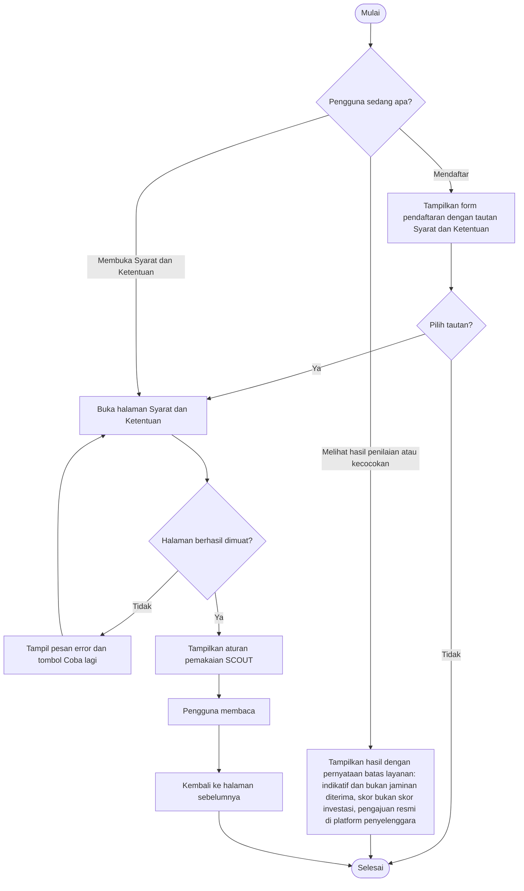

# User Flow: Disclaimer dan Syarat Ketentuan (US-18)

Tujuan: pengguna melihat pernyataan batas layanan SCOUT dengan jelas, agar tidak salah paham bahwa hasil SCOUT menjamin diterima atau merupakan saran investasi.

