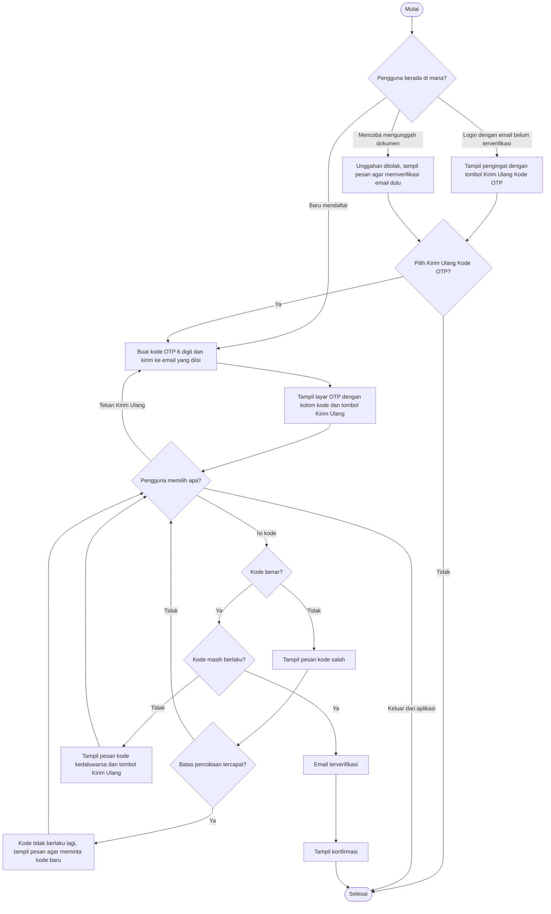

# User Flow: Verifikasi Email dengan OTP (US-24)

Tujuan: pengguna memverifikasi emailnya dengan kode OTP 6 digit, agar akun terbukti milik pengguna tersebut.
Titik awal: pengguna baru mendaftar, login dengan email yang belum terverifikasi, atau mencoba mengunggah dokumen sebelum verifikasi.
Titik akhir: email terverifikasi, atau pengguna meninggalkan aplikasi dengan akun yang masih belum terverifikasi.

Setiap kali kode baru dikirim (dari pendaftaran atau Kirim Ulang), kode sebelumnya tidak berlaku lagi.
