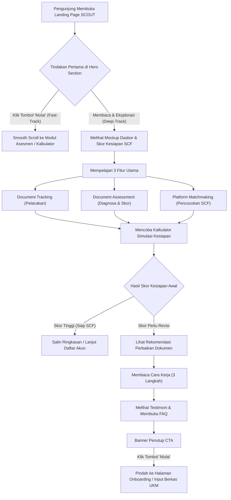

# Alur Layar Pengguna (User Flow) - Landing Page SCOUT

**Fitur:** Landing Page & Alur Konversi Awal  
**Versi:** 1.0  
**Tanggal:** 11 November 2026  

---

## 1. Pemetaan Fakta, Asumsi, dan Rencana Alur

- **Fakta:** Pengunjung landing page memiliki tingkat pemahaman yang beragam tentang *Securities Crowdfunding* (mulai dari yang baru mendengar istilah SCF hingga yang sudah pernah ditolak platform penyelenggara).
- **Asumsi:** Alur konversi bertingkat (*dual-track flow*)—jalur cepat bagi yang langsung mengklik "Mulai" di hero dan jalur eksplorasi bagi yang ingin membaca fitur dan simulasi terlebih dahulu—akan meningkatkan rasio retensi pengunjung.
- **Rencana:** Memasang pelacakan *event telemetry* pada setiap langkah alur (klik tombol, penggeseran slider kalkulator, pembukaan FAQ) untuk mengidentifikasi titik hambatan (*drop-off points*).

---

## 2. Diagram Alur Layar (Mermaid Diagram)

---

## 3. Deskripsi Alur Langkah demi Langkah

### Langkah 1: Kunjungan Pertama (*Page Arrival*)
- Pengguna mendarat di landing page SCOUT melalui tautan langsung, rujukan komunitas UKM, atau pencarian web.
- Halaman memuat instan dengan tema Kuning & Hitam tanpa jeda unduhan font pihak ketiga.
- Header sticky menampilkan identitas merek SCOUT dan tombol kuning "Mulai" yang selalu terlihat saat layar digulir.

### Langkah 2: Pilihan Jalur Pengguna (*User Branching*)
- **Jalur A (Langsung Beraksi):** Pengguna yang sudah membutuhkan solusi segera mengklik tombol **"Mulai"** di navbar atau hero banner. Layar secara mulus bergulir (*smooth scroll*) langsung ke formulir simulasi kesiapan awal.
- **Jalur B (Eksplorasi Informasi):** Pengguna menelusuri penjelasan nilai produk, mengamati mockup kartu dasbor kesiapan (skor 88/100), dan mempelajari tiga fitur inti SCOUT.

### Langkah 3: Interaksi dengan Tiga Fitur Inti
- Pengguna membaca spesifikasi 3 pilar:
  1. *Document Tracking:* Mengetahui cara kerja pemantauan status berkas legalitas dan keuangan.
  2. *Document Assessment:* Memahami bagaimana dokumen mereka dinilai dengan skala 0 - 100 sebelum diserahkan ke platform SCF.
  3. *Platform Matchmaking:* Memahami mekanisme pencocokan model bisnis mereka dengan platform SCF berizin OJK.

### Langkah 4: Pengujian Simulasi Kesiapan (*Interactive Assessment*)
- Pengguna memasukkan variabel bisnis mereka:
  - Bentuk badan usaha (PT / CV / Belum Berbadan Hukum).
  - Usia operasional bisnis (Tahun).
  - Rata-rata omzet tahunan dan target kebutuhan dana.
  - Ketersediaan laporan keuangan historis.
- Sistem memberikan indikasi kesiapan instan dan menampilkan poin perbaikan utama.
- Pengguna dapat mengklik tombol **"Salin Ringkasan"** untuk menyimpan catatan.

### Langkah 5: Penyelesaian Keraguan (*Objection Handling*)
- Pengguna meninjau ringkasan 3 langkah kerja SCOUT.
- Pengguna membaca testimoni pemilik UKM lain yang telah melalui proses pendampingan.
- Pengguna membuka akordeon FAQ untuk memastikan legalitas, biaya, dan kerahasiaan data pembukuan mereka.

### Langkah 6: Konversi Utama (*Action Conversion*)
- Pengguna mengklik tombol **"Mulai"** pada banner CTA di bagian bawah halaman.
- Pengguna diarahkan ke langkah selanjutnya (pendaftaran akun UKM dan pembuatan proyek pengajuan pendanaan SCF).

---

## 4. Penanganan Kasus Khusus (*Edge Cases & Fallbacks*)

| Skenario Khusus | Respons Antarmuka SCOUT |
|---|---|
| **Koneksi Internet Lambat** | Seluruh elemen teks dan struktur CSS termuat lebih awal; ikon SVG menggunakan inline rendering tanpa aset eksternal yang memblokir tampilan. |
| **Pengguna Menggunakan Layar Ponsel Kecil** | Menu navigasi otomatis terlipat menjadi *drawer* hamburger; slider kalkulator dilengkapi input angka manual yang mudah disentuh (*touch-friendly*). |
| **Pengguna Menolak Memberikan Data Detail** | Modul simulasi di landing page bersifat anonim dan tidak mewajibkan registrasi atau pengisian nama perusahaan sebelum melihat estimasi awal. |

